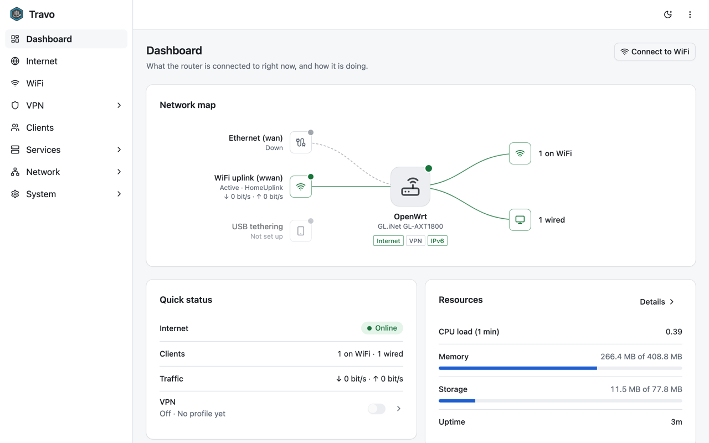
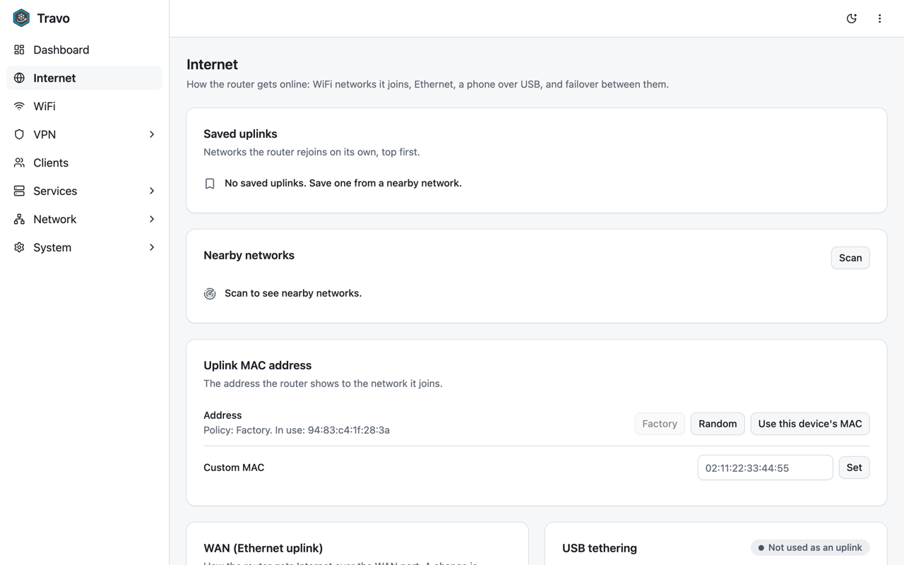
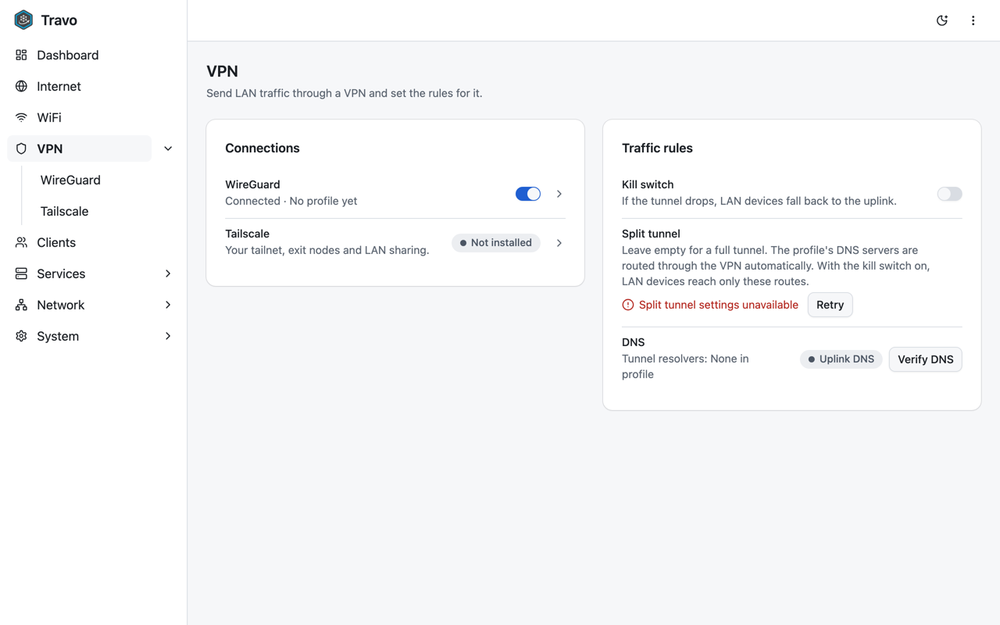
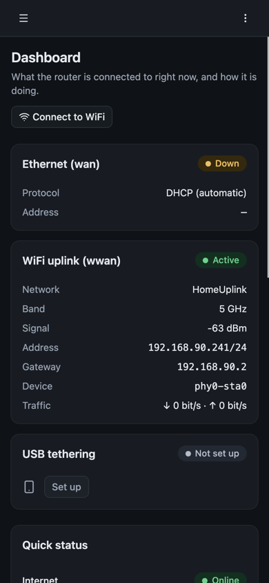

# Travo

A simple web UI for OpenWrt travel routers. Join the hotel WiFi, get through its login page, see at a glance whether you are online, switch your VPN on and off, and block ads for every device you carry. Travo runs on the router next to LuCI and never takes LuCI away.



Made for travellers who are not network admins, and for power users who want a clean API.

## What you get

- **Get online anywhere.** Scan and join WiFi, keep a list of saved networks by priority, reconnect automatically, use Ethernet or a phone over USB, and fail over between them.
- **Hotel and airport WiFi.** Travo spots a login page, offers it in one click and can accept simple ones by itself.
- **VPN.** WireGuard profiles (paste or upload), Tailscale with exit nodes, a kill switch and split tunnelling.
- **Ad and tracker blocking** with AdGuard Home, including DNS over HTTPS.
- **Your own WiFi.** Access point, guest network and an on/off schedule.
- **Clients.** See who is connected, give a device a fixed address, block or wake it.
- **Safe changes.** Anything that could cut you off (WiFi, VPN, firewall, LAN address, WAN) is applied, checked and then waits for you to confirm. If you lose the connection, the router rolls it back by itself.
- **Updates** from the UI, signed and with automatic rollback.
- **Works on a phone**, light and dark.

| Internet | VPN | On a phone |
|---|---|---|
|  |  |  |

## Supported routers

- OpenWrt 25.12 or newer on an aarch64 router. Tested on GL.iNet Slate AX (GL-AXT1800); Beryl AX (GL-MT3000) is expected to work.
- Start from a fresh OpenWrt installation.
- You need a root shell on the router (SSH or console).

## Install

1. Download `travo-<version>-aarch64.tar.gz` and `checksums.txt.sig` from the [latest release](https://github.com/raydak-labs/travo/releases/latest).
2. Copy both to the router, for example `scp -O travo-*.tar.gz checksums.txt.sig root@192.168.1.1:/tmp/`.
3. On the router, as root:

```sh
cd /tmp && mkdir -p travo && tar -xzf travo-*-aarch64.tar.gz -C travo
cp checksums.txt.sig travo/
sh travo/install.sh --wifi
```

The installer checks the release signature with the router's `usign` before it changes anything, and refuses an unsigned or tampered tarball.

| Option | Effect |
|---|---|
| `--port N` | Serve Travo on `http://<router>:N` and leave LuCI on port 80 |
| `--wifi` | Turn on the router's WiFi: asks for a password, the network is called **Travo** on every band (WPA2/WPA3). `--wifi-name NAME` picks another name; `TRAVO_WIFI_PASSWORD` skips the question in scripts |
| `--lan CIDR` / `--keep-lan` | The router's address. A first install moves OpenWrt's `192.168.1.1/24`, which hotel networks often use too, to `192.168.50.1/24` |
| `--hostname NAME` / `--keep-hostname` | First-install hostname (default `travo`, replaces factory `OpenWrt` only) |
| `--adguard-bundle <file>` | Install AdGuard Home offline from the release's `adguardhome-*.apk` |
| `--rotate-key` | Accept a new signing key once, when the release notes announce one |
| `--insecure` | Install an unsigned build you made yourself |
| `--uninstall` | Remove Travo and give port 80 back to LuCI; add `--purge` to delete its settings too |

## First use

The router's address is now `192.168.50.1`. Unplug and replug the cable (or join the **Travo** WiFi), open `http://192.168.50.1/` and choose the admin password. LuCI moves to `http://192.168.50.1:8080/`.

- Installed without `--wifi`? The banner says the WiFi is off; **WiFi → Set up WiFi** turns it on.
- To get online, press **Connect to WiFi** on the dashboard and pick the hotel's network.

- After `--port N`, open `http://<router>:N/` instead; LuCI stays on port 80.
- `https://<router>/` serves the same UI with a certificate the router made itself. Its fingerprint is in `logread -e travo`.
- Settings live in `/etc/config/travo`, so a normal OpenWrt backup or sysupgrade keeps them.

## Updating

Travo checks GitHub for a new release at most once a day, or when you press **Check for updates** under **System → Firmware**. **Verify package** downloads and checks the signed release; **Apply update** installs it, restarts Travo and rolls back by itself if the new version does not come up. Sign in again afterwards.

OpenWrt itself: **System → Firmware** shows whether a newer OpenWrt release exists and can flash an image you upload, after checking that it fits your router.

## Uninstall

```sh
sh /tmp/travo/install.sh --uninstall          # keep settings
sh /tmp/travo/install.sh --uninstall --purge  # delete settings too
```

Use the `install.sh` of the release you installed. LuCI moves back to port 80 with its original settings.

## Automation and API

Scripts on your LAN can use an API token instead of the browser login. Create one under **System → Access** and choose `read` or `admin`; the token is shown once.

```sh
curl -H "Authorization: Bearer tgt_..." http://192.168.1.1/api/v1/system/info
```

`read` tokens can only read. No token can manage tokens, change the password or flash firmware. The OpenAPI spec is served at `/api/openapi.json`.

## Known issues

- GL-AXT1800 on OpenWrt 25.12.6: the kernel's available memory slowly drops over hours. Travo warns on the dashboard below 15 MiB; a reboot frees it ([device facts](docs/device-facts.md)).

## Development

Needs [mise](https://mise.jdx.dev). No router required: the daemon runs against a mock device built from captured router data.

```sh
mise run dev          # UI on :18092 against the mock daemon on :18081
mise run check        # all checks; must pass before every commit
mise run gen          # regenerate the OpenAPI spec and TypeScript client after API changes
mise run screenshots  # PNGs of every page into web/screenshots/
mise run package      # release tarball
```

Contributors and coding agents start with [AGENTS.md](AGENTS.md). Work is tracked in [GitHub issues](https://github.com/raydak-labs/travo/issues).

- [Invariants](docs/invariants.md): rules for live state, auth, DNS and WiFi
- [Device facts](docs/device-facts.md): hardware behaviour learned on real routers
- [Testing](docs/testing.md): test layers and the hardware playbook
- [Web UI](docs/web-ui.md): page rules, dialogs and toasts
- [ADRs](docs/adr/README.md) and [glossary](GLOSSARY.md)

Travo 0.11 is a rewrite. The code of Travo 0.10 and earlier is on the [`legacy`](https://github.com/raydak-labs/travo/tree/legacy) branch.

License: [MIT](LICENSE).
